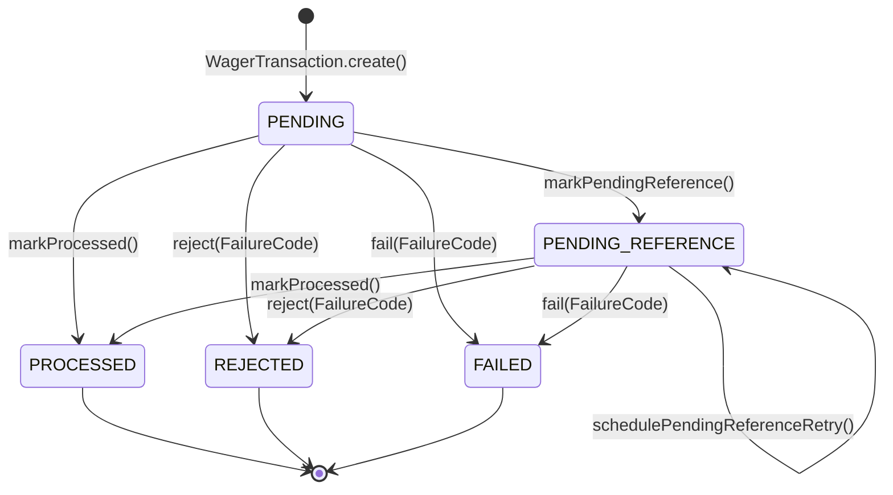

# ARCHITECTURE.md — Distributed Wagering Processor

Este documento descreve as decisões arquiteturais, estratégias de concorrência, garantias de consistência financeira, modelagem de banco de dados e trade-offs adotados no **Distributed Wagering Processor**.

---

## 1. Visão Geral da Arquitetura

A aplicação combina **Clean Architecture + Ports & Adapters (Hexagonal Architecture) + Tactical DDD**, organizada em fatias verticais por contexto delimitado (`shared`, `wallet`, `wagering`, `messaging`, `health`):

```
src/
├── shared/
│   ├── domain/          # Money, IntegrationEvent<T>, DomainError, FailureCode, CanonicalPayloadHash
│   ├── application/     # Ports transversais (UnitOfWorkPort, ClockPort, IdGeneratorPort, MetricsPort, etc.)
│   └── adapters/        # MikroOrmUnitOfWork, DomainExceptionFilter, CorrelationInterceptor, Logger, Metrics
└── modules/
    ├── wallet/          # Wallet (Aggregate Root), WalletLedgerEntry, Open/Get/ListLedger/Reconcile
    ├── wagering/        # WagerTransaction (Aggregate Root), ProcessWager, RetryPendingReference, SQS Consumer
    ├── messaging/       # InboxMessage, OutboxMessage, PublishPendingOutboxUseCase, OutboxPublisherWorker
    └── health/          # CheckReadinessUseCase, HealthController (/health/live, /health/ready, /metrics)
```

### Isolamento Estrito do Domínio
- A camada `domain/` é **100% TypeScript puro**, sem decorators do NestJS, sem metadados do MikroORM e sem dependências de transporte ou banco de dados.
- Todas as entidades e Value Objects possuem construtores `private` ou `protected`:
  - Novas instâncias de negócio são criadas exclusivamente por factories estáticas (`Money.from`, `Wallet.open`, `WagerTransaction.create`, `WalletLedgerEntry.create`, `InboxMessage.receive`, `OutboxMessage.enqueue`) que validam todas as invariantes na entrada.
  - A reconstrução a partir do PostgreSQL utiliza exclusivamente `.rehydrate(state)`, recompondo o estado persistido sem reexecutar regras de transição.

---

## 2. Escolha do ORM, Mapeamento de `Money` e Estratégia Transacional

### 2.1 Justificativa do MikroORM (`EntitySchema` + Mappers Explícitos)
Adotamos o **MikroORM v6 (`@mikro-orm/postgresql`)** por oferecer suporte explícito a Unit of Work, controle fino sobre `EntityManager` transacional e `LockMode.PESSIMISTIC_WRITE` (`SELECT ... FOR UPDATE`).

Para impedir que detalhes de infraestrutura vazem para o domínio:
1. Definimos os schemas de persistência em classes dedicadas (`*PersistenceRecord` + `new EntitySchema(...)`) dentro de `adapters/outbound/persistence/schemas/`.
2. Utilizamos **Mappers explícitos** (`WalletMapper`, `WalletLedgerEntryMapper`, `WagerTransactionMapper`, `InboxMessageMapper`, `OutboxMessageMapper`) para converter entre registros relacionais e agregados de domínio.

### 2.2 Mapeamento de `Money`
- **Em memória (`Money` VO):** encapsula uma instância de `Decimal` (`decimal.js`) e o código ISO-4217 da moeda (`BRL`, `USD`, etc.). Rejeita `number`, `NaN`, `Infinity`, notação científica, valores negativos em contratos de entrada e qualquer string que não possua escala decimal exata de 2 casas (`^\d+\.\d{2}$`).
- **No PostgreSQL:** armazenado em duas colunas separadas:
  - `amount` (`NUMERIC(20, 2) NOT NULL`): garante aritmética decimal exata no banco sem imprecisão de ponto flutuante IEEE 754;
  - `currency` (`VARCHAR(3) NOT NULL`): validada e reidratada junto com `amount` via `Money.from({ amount, currency })`.

### 2.3 Estratégia Transacional (`MikroOrmUnitOfWorkAdapter`)
O `MikroOrmUnitOfWorkAdapter` utiliza `EntityManager.transactional(...)` combinado com `AsyncLocalStorage<EntityManager>`. Quando um caso de uso executa `unitOfWork.runInTransaction(async () => { ... })`, todos os repositórios participantes (`WalletRepository`, `WalletLedgerRepository`, `WagerTransactionRepository`, `InboxRepository`, `OutboxRepository`) resolvem automaticamente o mesmo `EntityManager` transacional via `resolveActiveEntityManager()`.

Isso garante que **Inbox, mutação de saldo na Wallet, inserção no Ledger, gravação da WagerTransaction e enfileiramento na Outbox ocorram em uma única transação ACID no PostgreSQL**: ou tudo é confirmado junto no `COMMIT`, ou nada é persistido em caso de falha (`ROLLBACK`).

---

## 3. Concorrência e Ordenação (`Pessimistic Locking` + `version`)

A unidade de concorrência do sistema é a **`walletId`**.

### 3.1 Estratégia Adotada: Pessimistic Write Lock (`SELECT ... FOR UPDATE`)
Toda operação que avalia ou altera o saldo de uma carteira adquire um lock exclusivo de linha no PostgreSQL sobre a carteira alvo:

```sql
SELECT * FROM wallets WHERE id = $1 FOR UPDATE
```

Além do lock pessimista, a coluna `version` da tabela `wallets` inicia em `1` e **incrementa exclusivamente quando o saldo muda** (`wallet.debit` ou `wallet.credit`), preservando o rastreamento de versão de estado em cada evento `WalletBalanceChanged`.

### 3.2 Por que Pessimistic Locking em vez de Optimistic Locking Puro?
Em plataformas de iGaming, dois padrões de tráfego são críticos:
1. **Rajadas de Replay Idempotente:** Quando um provedor ou fila reenvia 50 vezes em paralelo a mesma aposta, o Optimistic Locking causaria 49 falhas de `OptimisticLockError`, exigindo loops de retry na aplicação e desperdiçando CPU e conexões. Com `SELECT ... FOR UPDATE` aliado à **dupla verificação de idempotência** (antes e imediatamente após adquirir o lock da wallet), a 1ª requisição processa e comita, enquanto as 49 seguintes aguardam menos de 1ms na fila de lock do PostgreSQL, leem a transação já comitada no check pós-lock (`postLockExisting`) e retornam `idempotentReplay: true` com o `observedBalance` original na primeira tentativa.
2. **Rejeições de Negócio Auditáveis em *Hot Wallets*:** No cenário obrigatório de saldo `100.00 BRL` com duas apostas simultâneas de `80.00 BRL`, a 2ª aposta não deve falhar com erro técnico de concorrência (`503`/`409`): ela precisa observar o saldo atualizado de `20.00 BRL` e **comitar** um registro auditável com `status = 'REJECTED'`, `failure_code = 'INSUFFICIENT_FUNDS_BET'`, `observed_balance_amount = '20.00'` e o evento `WagerTransactionRejected` na Outbox. O lock pessimista serializa as duas operações na mesma `walletId` de forma determinística, sem bloquear operações de outras wallets.

### 3.3 Prevenção de Deadlocks em Processamento em Lote
No `RetryPendingReferenceTransactionsUseCase`, um lote de transações `PENDING_REFERENCE` pode referenciar múltiplas carteiras. Antes de adquirir `findByIdForUpdate(walletId)`, o lote é ordenado por **`walletId ASC`** (e `createdAt ASC` como desempate). Essa ordem global estrita de aquisição de locks torna deadlocks entre carteiras estruturalmente impossíveis.

---

## 4. Desenho do Schema SQL, Constraints e Imutabilidade no Banco

As invariantes de domínio são reforçadas diretamente no schema PostgreSQL através de migrations versionadas e reversíveis (`Migration202611050001` e `Migration202611050002`):

| Tabela | Chave Primária / Índices Únicos | Constraints e Garantias no Banco |
|---|---|---|
| `wallets` | `PRIMARY KEY (id)`<br>`UNIQUE (player_id, currency)` (`uq_wallets_player_currency`) | `chk_wallets_balance_non_negative`: `CHECK (balance_amount >= 0)`<br>`chk_wallets_version_positive`: `CHECK (version >= 1)`<br>`chk_wallets_currency_len`: `CHECK (char_length(currency) = 3)` |
| `wager_transactions` | `PRIMARY KEY (id)`<br>`UNIQUE (idempotency_key)` (`uq_wager_tx_idempotency_key`)<br>`UNIQUE (provider_id, external_transaction_id)` (`uq_wager_tx_provider_external_id`) | `chk_wager_tx_amount_non_negative`: `CHECK (amount >= 0)`<br>Índice composto parcial para worker: `idx_wager_tx_pending_reference_due (status, next_attempt_at)` |
| `wallet_ledger_entries` | `PRIMARY KEY (id)`<br>`UNIQUE (wallet_id, transaction_id)` (`uq_wallet_ledger_wallet_tx`) | `chk_wallet_ledger_money_positive`: `CHECK (amount > 0)`<br>`chk_wallet_ledger_balances_non_negative`: `CHECK (balance_before >= 0 AND balance_after >= 0)`<br>`chk_wallet_ledger_arithmetic_balance`: valida `balance_before - amount = balance_after` (`DEBIT`) e `balance_before + amount = balance_after` (`CREDIT`)<br>**Trigger `trg_wallet_ledger_entries_immutable`**: bloqueia qualquer `UPDATE` ou `DELETE` na tabela |
| `inbox_messages` | `PRIMARY KEY (consumer_name, message_id)` | Deduplicação atômica via `INSERT ... ON CONFLICT (consumer_name, message_id) DO NOTHING` |
| `outbox_messages` | `PRIMARY KEY (id)` | Índice de varredura `idx_outbox_messages_pending_due (published_at, next_attempt_at, occurred_at)` usado com `FOR UPDATE SKIP LOCKED` |

---

## 5. Máquina de Estados de `WagerTransaction`, `FailureCode` e Status HTTP

### 5.1 Máquina de Estados (`WagerTransactionStatus`)



- `PROCESSED`, `REJECTED` e `FAILED` são **estados terminais imutáveis**. Qualquer tentativa de transicionar uma transação já terminal lança `InvalidTransactionStateError`.

### 5.2 Taxonomia de `FailureCode`

| `FailureCode` | Significado Operacional | Ação Recomendada ao Provedor |
|---|---|---|
| `INSUFFICIENT_FUNDS_BET` | Saldo insuficiente na wallet para cobrir um débito de `BET` | Não reenviar; informar jogador sobre saldo insuficiente |
| `INSUFFICIENT_FUNDS_REVERSAL` | Reversão (`ROLLBACK` de `WIN`/`REFUND`) deixaria o saldo da wallet negativo | Não reenviar automaticamente; encaminhar para revisão operacional/risco |
| `CURRENCY_MISMATCH` | Moeda da transação difere da moeda da wallet | Corrigir configuração de moeda/wallet no provedor |
| `REFERENCE_CONTEXT_MISMATCH` | Transação referenciada pertence a outro `providerId`, `playerId`, `walletId`, `currency` ou `roundId` | Corrigir dados de referência do payload |
| `REFERENCE_INVALID_KIND` | Tipo incompatível (ex.: `REFUND` apontando para `WIN`, ou `ROLLBACK` apontando para `LOSS`) | Corrigir tipo de operação submetida |
| `REFERENCE_NOT_PROCESSED` | A transação referenciada terminou em `REJECTED` ou `FAILED` | Não reverter uma operação que não foi aplicada |
| `REFERENCE_ALREADY_REVERSED` | A transação referenciada já foi revertida anteriormente pelo mesmo `kind` (`REFUND` ou `ROLLBACK`) | Tratar como operação já estornada; não reenviar |
| `REFERENCE_AMOUNT_MISMATCH` | Valor do `REFUND`/`ROLLBACK` difere do valor exato da transação referenciada | Ajustar valor para coincidir integralmente com a referência |
| `REFERENCE_NOT_FOUND_TIMEOUT` | A transação referenciada não chegou dentro do limite de tentativas/TTL do worker | Verificar se a transação original foi emitida pelo provedor |
| `PERMANENT_INFRASTRUCTURE_FAILURE` | Falha permanente não recuperável | Investigar DLQ / auditoria |

### 5.3 Mapeamento Consistente de Status HTTP

| Status HTTP | Situação | Retorno / Código |
|---|---|---|
| `200 OK` | Transação `PROCESSED` (incluindo `idempotentReplay: true`) ou consultas `GET` / reconciliação | Resultado da operação com `idempotentReplay` e `balance` observado |
| `201 Created` | Criação de nova carteira (`POST /wallets`) | Estado inicial da `Wallet` (`version: 1`) |
| `202 Accepted` | Transação aceita em `PENDING_REFERENCE` (aguardando chegada da referência fora de ordem) | `status: "PENDING_REFERENCE"` |
| `400 Bad Request` | Payload malformado, `Money` inválido, `Idempotency-Key` ausente, `OPENING` externo, cursor inválido | `DomainValidationError` com `errorCode` |
| `404 Not Found` | `Wallet` ou `WagerTransaction` inexistente | `ResourceNotFoundError` |
| `409 Conflict` | Mesma `Idempotency-Key` com payload diferente (`IdempotencyConflictError`) ou wallet duplicada (`playerId` + `currency`) | `errorCode: "IDEMPOTENCY_CONFLICT"` / `"WALLET_ALREADY_EXISTS"` |
| `422 Unprocessable Entity` | Transação `REJECTED` por violação de regra de negócio (saldo insuficiente, moeda divergente, referência inválida) | `status: "REJECTED"` + `failureCode` legível por máquina |
| `503 Service Unavailable` | Falha transitória de infraestrutura ou dependência indisponível em `GET /health/ready` |Provedor autorizado a repetir a requisição com a mesma `Idempotency-Key` |

---

## 6. Idempotência Canônica e Processamento Assíncrono

### 6.1 Algoritmo de `payloadHash` (`CanonicalPayloadHash`)
O hash de payload (`SHA-256` em hexadecimal) é calculado exclusivamente sobre o subconjunto de campos de negócio normalizados:
`providerId`, `externalTransactionId`, `playerId`, `walletId`, `roundId`, `gameId`, `kind`, `money: { amount, currency }` e `referenceExternalTransactionId` (quando presente).
- As chaves de objetos JSON são ordenadas lexicograficamente de forma recursiva antes da serialização, garantindo que `{ "amount": "25.00", "currency": "BRL" }` e `{ "currency": "BRL", "amount": "25.00" }` produzam exatamente o mesmo hash.
- Metadados de transporte (`Idempotency-Key`, `X-Correlation-Id`, `messageId`) não entram no cálculo do hash.
- **Replay vs Conflito:**
  - Mesma `Idempotency-Key` + mesmo `payloadHash` → retorna o resultado original (`idempotentReplay: true`) e o **`observedBalance` gravado no momento da execução original**.
  - Mesma `Idempotency-Key` + `payloadHash` divergente → lança `IdempotencyConflictError` (`409 Conflict`).

### 6.2 Referências Fora de Ordem (`PENDING_REFERENCE`)
Quando um `REFUND`, `ROLLBACK`, `WIN` ou `LOSS` referencia uma `referenceExternalTransactionId` que ainda não existe (ou está pendente):
1. A transação é persistida com `status = 'PENDING_REFERENCE'`, `next_attempt_at = now + 1000ms`, e o evento `WagerTransactionPendingReference` é gravado na Outbox.
2. O `PendingReferenceWorker` executa a cada `1s` o `RetryPendingReferenceTransactionsUseCase`, buscando lotes vencidos com `FOR UPDATE SKIP LOCKED`.
3. **Backoff Exponencial e Limites Justificados:**
   - Delay base de `1s` dobrando a cada tentativa (`1s`, `2s`, `4s`, `8s`, `16s`, teto de `30s`).
   - Limite padrão de **`maxAttempts = 5` tentativas** ou **TTL de `60s` (`maxTtlMs = 60_000`)**: em integrações de iGaming, atrasos legítimos de rede/partição entre `BET` e `REFUND`/`ROLLBACK` ocorrem na janela de milissegundos a poucos segundos. Se a transação referenciada não chegou após 5 tentativas ou 60 segundos, trata-se de referência órfã; a transação é transicionada para `REJECTED` com `FailureCode.ReferenceNotFoundTimeout` e o evento `WagerTransactionRejected` é publicado via Outbox.

### 6.3 Consumidor SQS FIFO, Transactional Inbox, DLQ e Graceful Shutdown
O `WagerTransactionSqsConsumer` consome `wager-transactions.fifo`:
- **Reuso Integral do Caso de Uso:** delega para `ProcessWagerTransactionUseCase.execute(...)` informando `inboxEnvelope: { consumerName: "wager-transactions-sqs-consumer", messageId }`.
- **Transactional Inbox:** o registro em `inbox_messages` é inserido (`ON CONFLICT DO NOTHING`) e marcado como `processed_at` dentro da mesma transação SQL que altera `Wallet`, `Ledger`, `WagerTransaction` e `Outbox`.
- **`ack` Estritamente Pós-Commit:** o comando `DeleteMessageCommand` só é enviado ao SQS após o retorno bem-sucedido do `unitOfWork.runInTransaction(...)`. Se o worker morrer entre o commit SQL e o `DeleteMessageCommand`, a reentrega da mensagem pelo SQS encontra o `InboxMessage` já processado, não repete nenhum efeito financeiro e confirma o `ack`.
- **Classificação de Falhas:**
  - *Erro de negócio (`REJECTED`):* estado terminal já comitado no banco → `ack` (`DeleteMessageCommand`).
  - *Erro transitório (`TransientInfrastructureError`, timeout de banco) com `ApproximateReceiveCount < 5`:* não faz `ack` e aplica backoff exponencial no `VisibilityTimeout` via `ChangeMessageVisibilityCommand`.
  - *Erro permanente (JSON inválido, envelope incorreto, `DomainValidationError`, `IdempotencyConflictError`, `ResourceNotFoundError`) ou `ApproximateReceiveCount >= 5`:* publica o envelope de diagnóstico em `wager-transactions-dlq.fifo` e remove da fila principal (`DeleteMessageCommand`), evitando bloquear o `MessageGroupId` da wallet.
- **Graceful Shutdown (`SIGTERM` / `OnModuleDestroy`):** interrompe novos polls, aguarda até `drainTimeoutMs` (`5s`) para que mensagens em voo terminem o commit+ack e, caso alguma mensagem permaneça pendente, executa `ChangeMessageVisibilityCommand` com `VisibilityTimeout = 0` para devolvê-la imediatamente à fila.

---

## 7. Autenticação: Decisão de Escopo e Desenho de Extensão (OIDC)

Conforme permitido na **Seção 2 do `README.md`** (0 pontos na matriz de avaliação), optamos por focar 100% do timebox em correção financeira, concorrência, idempotência, mensageria e testes reais, deixando o ponto de extensão de autenticação explicitamente modelado e desacoplado no código:

1. **Port de Domínio/Aplicação (`ProviderIdentityPort` em `src/shared/application/ports/outbound/provider-identity.port.ts`):**
   - Define o contrato `verifyToken(authorizationHeader?: string): Promise<ProviderPrincipal>` retornando `{ subject: string; providerId?: string; scopes: readonly string[] }`.
2. **Guard HTTP (`NoopAuthGuard` em `src/shared/adapters/inbound/http/guards/noop-auth.guard.ts`):**
   - Aplicado a `WalletController` e `WageringController` (enquanto `HealthController` permanece aberto sem guard, conforme exigido na Seção 9).
   - Atualmente delega para `NoopProviderIdentityAdapter`.
3. **Desenho de Produção com Identity Provider Externo (Keycloak / Zitadel via OIDC Client Credentials):**
   - Cada provedor de jogos (`provider-a`, `provider-b`) autentica-se no IdP via **OAuth 2.0 Client Credentials Flow** (`grant_type=client_credentials`) e recebe um Access Token JWT assinado (`RS256`/`ES256`) contendo a claim `provider_id` e os escopos (`wagering:write`, `wagering:read`, `wallet:read`, `wallet:write`).
   - Para ativar em produção, basta substituir a injeção de `PROVIDER_IDENTITY_PORT` em `SharedModule` por um `OidcJwksProviderIdentityAdapter` que valida a assinatura via endpoint JWKS do Keycloak/Zitadel, verifica `iss`, `aud`, `exp` e assegura que `principal.providerId === request.body.providerId`, sem alterar uma única linha nos Controllers ou Use Cases.

---

## 8. Trade-offs e Limitações Conhecidas

1. **Contenção em uma Única *Super-Hot Wallet* (`SELECT ... FOR UPDATE`):**
   - *Trade-off:* O lock pessimista serializa as transações pertencentes à mesma `walletId`. Para carteiras de jogadores reais (onde um humano ou sessão de jogo realiza algumas apostas por segundo), o tempo de lock (< 2ms por transação local) oferece vazão de centenas de operações/s por carteira sem nenhum retry abortado. Wallets de jogadores distintos escalam horizontalmente sem qualquer bloqueio mútuo.
2. **Polling em Intervalo Fixo para Outbox e Pending References (`@Interval`):**
   - *Trade-off:* Utilizamos workers baseados em polling com `FOR UPDATE SKIP LOCKED` (intervalo de `1s`), que são simples, resilientes a falhas e seguros para múltiplas instâncias. Em cenários de latência sub-100ms para publicação de eventos, poderíamos combinar `LISTEN/NOTIFY` do PostgreSQL ou CDC (Debezium) mantendo o polling `SKIP LOCKED` como fallback de segurança.
3. **Métricas em Memória por Instância (`InMemoryMetricsAdapter`):**
   - *Trade-off:* O adaptador padrão mantém contadores e percentis em memória por processo (expostos em `GET /metrics`), evitando dependências externas adicionais no `docker-compose.yml`. Por estar abstraído atrás de `MetricsPort`, pode ser substituído diretamente por `prom-client` (Prometheus) ou OpenTelemetry SDK em produção.

